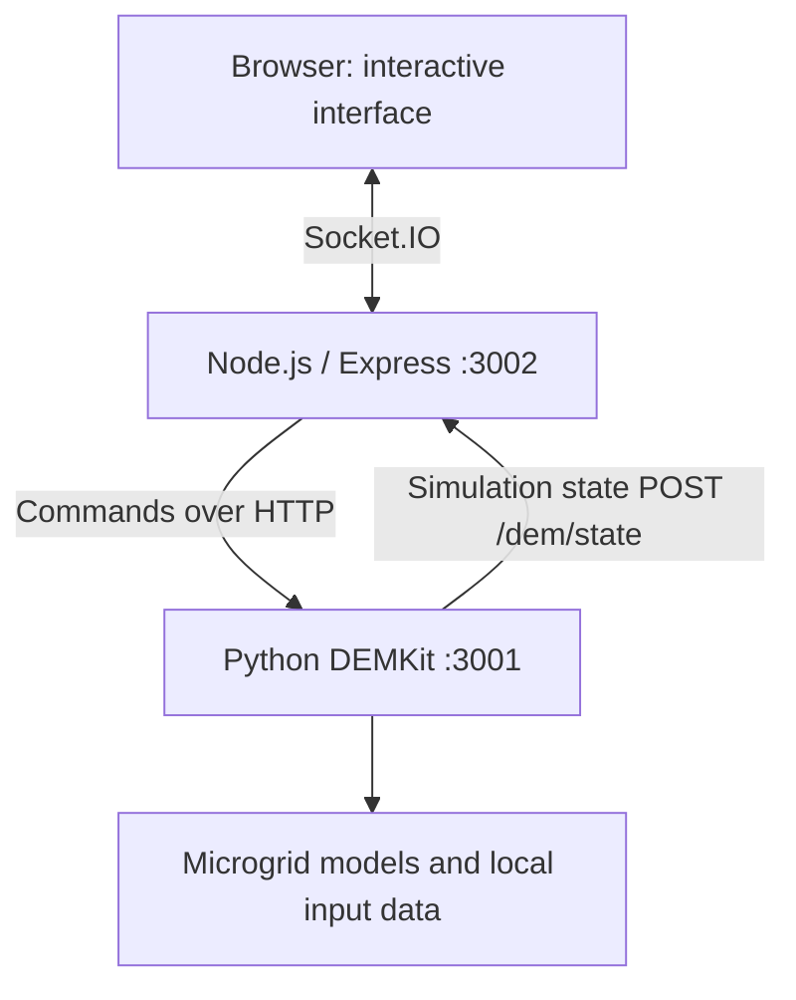

# DEMKit Microgrid Simulator

**An interactive educational microgrid simulation for exploring local electricity demand, solar generation, electric vehicles, battery storage, and grid constraints.**

> **Project status — development / educational prototype.** The inherited Microgrid Touchtable runs locally in a Windows development environment, but a clean installation, automated launcher, packaged releases, and macOS/Linux support have **not** yet been verified. Those are goals of this project, not existing release features.

This repository builds on the **Microgrid Touchtable** handed over by [Boxing Jiang](https://github.com/Jiangboxing/touchtable-tool), which itself uses **DEMKit** (University of Twente), DEMKit-Touchtable, and webbased-visualizer components. The current assignment focuses on making the simulator easier to install, more reliable, and more useful for students and teachers. See [credits and licensing](#credits-and-licensing).

## Why this project?

A neighbourhood electricity grid has limits. Adding electric vehicles, solar panels, and home batteries changes when electricity is consumed, produced, stored, and exchanged with the grid. The simulator gives learners a way to experiment with those changes and observe the consequences.

**Target users:** students exploring the energy transition, teachers running interactive lessons, and developers maintaining the simulation.

## What the inherited simulator already includes

- A browser-based neighbourhood view with **six houses** and an electricity network.
- Drag-and-drop energy devices, including EV charging, solar, household loads, and batteries.
- Live house power/load information and transformer current visualization.
- Educational goals, a coin budget, device prices, slot limits, and rewards.
- Contextual feedback about grid load, overloads, and cable restoration.
- Battery strategy controls (Solar, Smart, and manual charge/discharge) in the supplied code.
- A Python-based DEMKit simulation engine and a Node.js/Express + Socket.IO web layer.

These are **features present in the inherited code**, not a claim that every scenario has passed regression testing. Refer to [HANDOVER.md](HANDOVER.md) for behaviour and known limitations.

## Assignment objectives

| Area | Intended outcome | Current status |
| --- | --- | --- |
| Reproducible setup | Document and stabilise Python/Node dependencies and configuration | Planned |
| One-action startup | Launch backend and frontend, check readiness, open the interface, and stop cleanly | Planned |
| Easier distribution | Produce a usable Windows installer or portable build | Planned |
| Cross-platform support | Investigate, implement, and validate macOS and Linux builds where feasible | Planned — not supported claims |
| Reliability | Add smoke tests, basic automated tests, helpful errors, and recovery behaviour | Planned |
| Classroom usability | Improve clarity, accessibility, and teacher/student onboarding | Planned |
| Educational enhancements | Explore live charts, guided lessons, presets, and scenario comparison | Proposed; requires prioritisation |

**Near-term focus:** installation, startup, reliability, and baseline testing. **InfluxDB integration and persistent analytics are out of scope for now.** We will investigate whether the existing logging dependency can be made optional without changing simulation correctness.

## Architecture



The browser displays the neighbourhood and accepts device interactions. Node.js relays those interactions to DEMKit and broadcasts the returned simulation state. DEMKit handles energy simulation; Node.js is **not** the simulation engine.

Key locations:

| Path | Purpose |
| --- | --- |
| `demkittt/demkit.py` | Python DEMKit entry point |
| `demkittt/conf/usrconf.example.py` | Template for local DEMKit configuration |
| `workspace/touchtable/model/` | Neighbourhood, houses, network, and simulation models |
| `workspace/touchtable/web/index.js` | Express/Socket.IO middleware and command forwarding |
| `workspace/touchtable/web/static/` | Browser interface and interactive JavaScript |
| `workspace/touchtable/touchtafel.bat` | Existing Windows launcher, with hardcoded paths |
| `HANDOVER.md` | Technical handover and known issues |

For additional detail, see [docs/ARCHITECTURE.md](docs/ARCHITECTURE.md).

## Running the current development version (Windows)

**This is a development setup, not a one-click installation.** It requires Git, Python, and Node.js. The historic web manifest specifies Node 11/npm 6; newer toolchains have not been systematically validated. One developer has run the tool locally using Python 3.12 and Node 22, but a clean-install compatibility matrix is still needed.

1. Clone and enter the repository:

   ```powershell
   git clone https://github.com/kiarashdelavar/demkit-microgrid-simulator.git
   cd demkit-microgrid-simulator
   ```

2. Create a virtual environment and install Python packages:

   ```powershell
   py -3.12 -m venv .venv
   .\.venv\Scripts\python.exe -m pip install -r requirements.txt
   ```

3. Install the Node.js dependencies:

   ```powershell
   cd workspace\touchtable\web
   npm ci
   cd ..\..\..
   ```

4. Copy the local configuration template:

   ```powershell
   Copy-Item demkittt\conf\usrconf.example.py demkittt\conf\usrconf.py
   ```

   In `demkittt/conf/usrconf.py`, set the following four values to match the checkout on **your** machine (use forward slashes and trailing `/`): `componentPath`, `workspacePath`, `demCfg['env']['path']`, and `demCfg['workspace']['path']`. Do **not** commit this file or real credentials.

5. Start the Python simulation in terminal 1, from the repository root:

   ```powershell
   .\.venv\Scripts\python.exe .\demkittt\demkit.py -f touchtable/model -m touchtable
   ```

   Wait until the DEMKit interface reports that it is listening on port **3001**.

6. Start Node.js in terminal 2:

   ```powershell
   cd workspace\touchtable\web
   node index.js
   ```

7. Open **http://localhost:3002**. Click **Start Mission** to begin the initially paused simulation.

Stop both services with `Ctrl+C` in their respective terminals. The existing `.bat` file has machine-specific absolute paths and should not be assumed to work on another computer without modification. See [HANDOVER.md](HANDOVER.md) for troubleshooting and full context.

## Planned development roadmap

1. **Phase 0 — Baseline:** record the working environment, map dependencies, and manually test key simulation behaviours.
2. **Phase 1 — Reliable startup:** remove machine-specific launcher assumptions, add readiness checks, error reporting, and controlled shutdown; handle optional database logging safely.
3. **Phase 2 — Distribution:** evaluate packaging options, build and test a Windows release, then investigate macOS and Linux compatibility.
4. **Phase 3 — Classroom experience:** improve readability and onboarding, test with learners/teachers, and prioritise a small set of educational additions.
5. **Phase 4 — Release quality:** automated tests, release process, clear technical documentation, and a reproducible demonstration.

Roadmap order and scope are **proposed**, subject to supervisor feedback, technical findings, and time available. Detailed tasks and acceptance criteria are in [backlog/PRODUCT_BACKLOG.md](backlog/PRODUCT_BACKLOG.md).

## Project documentation

- [Project plan, scope, and definition of done](docs/PROJECT_PLAN.md)
- [System architecture](docs/ARCHITECTURE.md)
- [Test strategy and baseline checklist](docs/TEST_PLAN.md)
- [Sprint 1 manual simulation test results (in progress)](docs/TEST_RESULTS_SPRINT1.md)
- [Local installation and configuration guide](docs/CONFIGURATION_GUIDE.md)
- [Prioritised product backlog](backlog/PRODUCT_BACKLOG.md)
- [Previous developer's technical handover](HANDOVER.md)

## Credits and licensing

- **Inherited project/handover:** [Boxing Jiang — touchtable-tool](https://github.com/Jiangboxing/touchtable-tool).
- **Underlying simulation research/software:** DEMKit, University of Twente (CAES and MOR groups), and the original DEMKit-Touchtable/webbased-visualizer contributors.
- **Current continuation:** installation, distribution, testing, documentation, and proposed classroom enhancements in this repository.

This repository includes third-party code with existing notices and licensing restrictions. **Preserve all upstream copyright and license text**, including [demkittt/LICENSE.pdf](demkittt/LICENSE.pdf). The included DEMKit notices refer to **non-commercial scientific purposes**; repository publication does **not** imply unrestricted redistribution, commercial use, or relicensing. Seek confirmation from the relevant supervisors/rights holders before distributing installers or making additional license claims. Do not add a blanket license for inherited components without verifying the rights.

This is an educational development effort, not an official production release from the University of Twente or Saxion.
