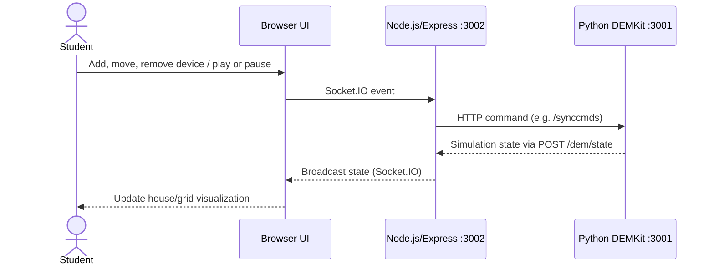

# Architecture — Current Microgrid Touchtable

**Status:** Inherited architecture, summarised from `HANDOVER.md`; not a redesign proposal.

## High-level flow

## Modules

| Module | Main path | Responsibility |
| --- | --- | --- |
| DEMKit launcher | `demkittt/demkit.py` | Loads local configuration and the specified simulation model |
| DEMKit components | `demkittt/components/` | Energy devices, controllers, host, and simulation mechanics |
| Touchtable model | `workspace/touchtable/model/` | Six-house environment, streets, networks, settings, ALPG/weather input |
| Node middleware | `workspace/touchtable/web/index.js` | Express endpoints, Socket.IO, command forwarding, state broadcasting |
| Browser UI | `workspace/touchtable/web/static/` | Device interaction, visualization, game rules and feedback |
| Windows start script | `workspace/touchtable/touchtafel.bat` | Starts Python, waits a fixed delay, then starts Node; has absolute paths |

## Relevant UI sources

- `static/js/devices.js` — drag/drop, touch interaction, scaling and device operations.
- `static/js/sockets.js` — Socket.IO communication with Node.
- `static/js/sim.js` — pause/play control and simulation control state.
- `static/js/gamefication.js` — goals, coins, slots, rewards, context feedback, battery buttons. **Filename is intentionally `gamefication.js`.**
- `static/js/network.js` — electric-network visualization.
- `static/js/overloadWarnings.js` — house-cable lookup and overload feedback.

All paths in this list are relative to `workspace/touchtable/web/` unless otherwise noted.

## Simulation basics

- Current baseline: six houses, 15-minute simulated steps, initial simulation date of 1 January 2019.
- DEMKit's HTTP interface is expected on port `3001`; Node serves the browser on `3002`.
- Model output can show house load, power, transformer current and device state.
- The browser's **Start Mission** button begins an initially paused simulation.
- The project uses ALPG profiles and weather/solar input data supplied with the model.

## Legacy integration and known risks

- Local paths in `usrconf.py` and `touchtafel.bat` must be tailored to each machine.
- `touchtafel.bat` waits 30 seconds rather than waiting for actual backend readiness.
- Logging through InfluxDB may fail; the inherited handover does not verify successful result storage.
- Web `package.json` declares Node 11/npm 6; actual modern-runtime compatibility must be established by tests.
- The original Docker workflow has not been shown equivalent to the current Windows launcher.
- Successful HTTP responses are not sufficient to prove simulation results are scientifically correct.
- Generated `touchtable_composed.py`, caches and output data are not source files to edit directly.

## Architectural direction (proposed, not implemented)

Start with the existing Python + Node + browser architecture. Develop a small launcher that:

1. Resolves relative installation paths and loads a safe local configuration.
2. Checks dependencies or uses packaged runtimes.
3. Starts DEMKit and waits for real service readiness.
4. Starts Node.js and verifies the web service.
5. Opens the browser and provides understandable diagnostics.
6. Stops child processes cleanly.

Packaging approaches (Docker, Electron plus a Python executable, Tauri sidecar, or a portable launcher) are **options to evaluate**, not chosen technologies. Prioritise correctness and maintainability before repackaging the simulation.

See the [original handover](../HANDOVER.md) for detailed file-level notes and battery parameters.
